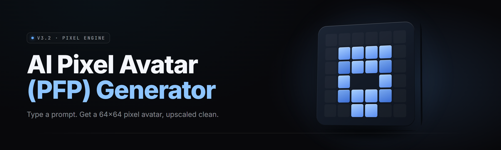

  
  
  

  

  
  
  

---

**Drop a prompt. Get a grid-perfect pixel PFP. No drawing tablet, no `.psd`, no fighting indexed palettes at 3am.**

---

## 🎨 Module Overview

AI Pixel Avatar (PFP) Forge is a Windows `.exe` that turns a text prompt into a pixel-art avatar sized, graded, and palette-locked for use as a profile picture. It runs a small local diffusion backend tuned on sprite sheets, quantizes the output into a fixed palette, and snaps every edge to the pixel grid so your avatar stays crunchy at 16px and at 512px. Everything it produces drops straight into Discord, X, TikTok, Steam, or a forum profile slot.

The forge is built around a **generation core** plus **seven finishing bays** — grid, palette, outline, background, animation, upscale, and export. Each bay is a module you can toggle. Turn them all on for a polished PFP, or run just the core when you want raw pixel noise to edit by hand.

---

## 📦 The Problem

- Prompt-based generators output blurry AI mush — anti-aliased edges that fall apart the second you shrink them to 32px.
- Indexed-palette tools fight you: every brush stroke re-quantizes and the program re-maps a color you already picked.
- Web generators lock you to 512×512 and watermark the export unless you pay per credit.
- Animation gets ignored. A static PFP on a platform that supports animated avatars wastes your whole slot.
- Cutting a clean circular face-crop for a PFP frame by hand is tedious and never lines up twice.
- Swapping the background to transparent, one universal color, or a checkered pattern usually breaks the sprite silhouette.
- Batch work is impossible — you regenerate one at a time and lose track of which seed made the good one.

  

---

## 🗺️ The Solution

| Pain point | How the Forge handles it |
|---|---|
| Blurry AI mush | Hard-grid quantizer snaps every boundary to whole pixels, nearest-neighbor throughout |
| Palette fights | Lockable palette presets + custom `.gpl` import; re-quantization is opt-in per stroke |
| Locked samples | Full-resolution `PNG` / `GIF` / `APNG` / `WEBP` export, no cap, no watermark |
| Static-only output | Built-in frame tween interpolator with per-frame hold control |
| Manual face-crop | Circle-safe guide + auto-center head detection for PFP frames |
| Broken backgrounds | Silhouette-preserving alpha cut with a visible checkered preview mode |
| One-at-a-time grind | Seed-locked batch grid: up to 64 variants in a session, each keeps its seed |

---

## 🧩 What is AI Pixel Avatar (PFP) Forge?

| Term | Explanation |
|---|---|
| **Grid quantize** | Snaps generated output toward a chosen pixel grid (16/32/48/64/128) so edges stay hard. |
| **Palette lock** | Restricts output to a fixed color set — Great Wave 32, DMG green, NES, or your own `.gpl`. |
| **Turbo sprite pass** | Fast preview render at low step count so you can iterate before the final pass. |
| **Diffusion step** | One denoise iteration. More steps = cleaner detail but slower. |
| **Seed** | Integer that fully determines a generation. Same seed + same prompt = same sprite every time. |
| **Palette dither** | Checkerboard blending between two palette colors; adds shade without adding color count. |
| **Frame tween** | Generator-produced intermediate frames between two anchor frames for a smooth animated PFP. |

Five reasons players keep the Forge open next to their art app:

- It never rounds your edges — the quantizer works on the pixel lattice, not the pixel grid after the fact.
- Every module is a bay you can switch off, so a 16×16 icon run doesn't ship with an animation rig attached.
- Seed-locked batching means the good one from a 64-sprite sheet is reproducible on demand.
- Palette import is one drag: drop a `.gpl`, and every bay adopts it immediately.
- Exports keep the same palette you previewed — the PNG and the GIF never disagree about a single color.

---

## ⚡ Quick Start

1. 🌐 Visit the project page and grab the current 2026 build.
2. 📁 Extract the `.zip` anywhere you can write files (avoid a read-only `Program Files` path).
3. 🖱️ Double-click the `.exe` to launch the Forge.
4. ⌨️ Type a prompt like `ranger, green cloak, wooden bow, 64px` and press **Generate**.
5. 🎛️ Pick a bay — palette, grid, outline, background — and export when the preview lands.

---

## 🔧 Installation

AI Pixel Avatar (PFP) Forge is distributed as a portable folder. No installer, no service, no background daemon.

1. **Download and unpack.** Get the current 2026 archive from the project page, right-click, and extract to a folder you control — `D:\PFPForge` or `%USERPROFILE%\Documents\PFPForge` both work.

2. **First launch.** Run the `.exe`. The Forge writes a `config.toml` and a `models/` folder next to itself on first boot, then does a one-time model warm-up (about 20–40 seconds on a mid-range GPU).

3. **Palette pack (optional).** Drop any `.gpl` / `.pal` files into `palettes/` before launch and they appear in the palette bay on startup. Portable, no registry writes.

---

## 🖼️ Comparison

| Aspect | Web PFP generators | Desktop pixel editors | AI Pixel Avatar (PFP) Forge |
|---|---|---|---|
| Generation from prompt | Yes, cloud-ruled | No, draw by hand | Yes, local |
| Palette enforcement | Rarely | Manual per pixel | Automatic + lockable |
| Pixel-grid snapping | Almost never | On export only | On every render |
| Animated avatar | Static only | Plugin-dependent | Native frame tween |
| Offline use | No | Yes | Yes |
| Watermark / cap | Often | Never | Never |
| Batch seeds | One per credit | No | Up to 64 per session |
| Export formats | PNG/JPG | App-dependent | PNG/GIF/APNG/WEBP |

---

## 🧭 Table of Contents

- [Generation Core](#-generation-core)
- [Grid & Pixel Bay](#-grid--pixel-bay)
- [Palette Bay](#-palette-bay)
- [Silhouette & Outline Bay](#-silhouette--outline-bay)
- [Background Bay](#-background-bay)
- [Animation Bay](#-animation-bay)
- [Upscale & Export Bay](#-upscale--export-bay)
- [All Modules Status](#-all-modules-status)
- [Key Features](#-key-features)
- [System Requirements](#-system-requirements)
- [Usage Guidelines](#-usage-guidelines)
- [Known Issues](#-known-issues)
- [FAQ](#-faq)

---

## 🎮 Generation Core

The diffusion engine that turns text into a sprite.

| Feature | Effect |
|---|---|
| Text-to-pixel pipeline | Prompt to alt-pixel render in one pass |
| Turbo preview mode | ~10-step fast pass so you can iterate before the final render |
| Seed lock | Reproduce a render exactly from its seed, forever |
| Negative prompt slot | "blurry, anti-aliased, photo" bans keep output crunchy |
| Style presets | `NES`, `MD`, `SNES`, `Pico-8`, `Modern 32`, `Blank` |
| Batch grid | Up to 64 seeds in one sheet, each labeled with its seed |

### Core submodules

| Feature | Effect |
|---|---|
| Prompt scaffolder | Rewrites a bare prompt into a prompt the pixel model actually reads well |
| Character memory | Save a character's look across generations so a PFP series stays on-model |
| Landmark grid overlay | Faint crosshair at head-center for consistent framing across a batch |
| Seed grid sheet | Tiled contact sheet of up to 64 renders with seed captions |

---

## 📐 Grid & Pixel Bay

Where the forge hardens your edges.

| Feature | Effect |
|---|---|
| Grid snapper | Nudges every rendered edge to the nearest pixel boundary |
| Target-resolution picker | 16 / 32 / 48 / 64 / 128 / 256 |
| Non-square support | Keyed avatars like 64×96 without stretching |
| Nearest-neighbor pipeline | Prevents interpolation blur in every resize stage |
| Edge-loss warning | Flags when a target grid is too low for prompt detail |
| Grid preview hatch | Overlays a hairline grid so you can eyeball breakage |

---

## 🧂 Palette Bay

Colors as a hard rule, not a suggestion.

| Feature | Effect |
|---|---|
| Palette presets | Great Wave 32, DMG green, NES 54, CGA 16, Game Boy, 1-bit two-tone |
| Custom `.gpl` import | Drop your own palette; every bay adopts it instantly |
| Palette lock | Freezes the counts while you edit — no silent re-quantization |
| Dither toggle | Checkerboard shading without adding colors |
| Palette swap preview | Live-swaps between two palettes for a side-by-side |
| Color-count readout | Live count of every.unique values so you know exactly what you're shipping |

---

## 🪓 Silhouette & Outline Bay

The clean cut silhouette that makes a PFP pop.

| Feature | Effect |
|---|---|
| Auto-outline | 1px intent, side-aware — no more drawing outlines by hand |
| Silhouette dump | Generates a flat alpha-filled sprite shell for quick reuse |
| Circle-safe frame | Mask overlay matching Discord / forum avatar frames |
| Head centering | Detects the head mass and recenters it for a frame-ready composition |
| Edge cleanup | Removes stray single-pixel noise at the silhouette boundary |

---

## 🧊 Background Bay

Kill the background, keep the shape — or build a whole scene.

| Feature | Effect |
|---|---|
| Alpha cut | Clear mode with no alpha-fringing at the silhouette |
| Flat fill / universal color | Drop a single color — key-green, sky, paper — behind the sprite |
| Dither backdrop | Checkered pattern behind a translucent sprite preview |
| Scene inject | Prompt a whole backdrop; the sprite gets alpha-matted on top |
| Background library | Presets: grass, tiled room, starfield, tiled dungeon, sky, nebula |
| Asymmetric damage | Guard-rail for edges that fall outside the resolved body |

---

## 🎬 Animation Bay

Motion for animated PFP slots and chat avatars.

| Feature | Effect |
|---|---|
| Frame tween | Interpolates between two anchor frames — up to 32 frames |
| Loop composer | Live preview with adjustable frame hold time |
| APNG/GIF/WEBP export | Straight to any of the three |
| Onion-skin view | Ghost of the previous frame behind the work canvas |
| Sprite-sheet compiler | Toggles into a single sheet with per-output labeling |
| Motion presets | `breath`, `wing-flap`, `header idle`, `attack-wind` |

---

## 🚀 Upscale & Export Bay

Getting the pixel you want at the size you need.

| Feature | Effect |
|---|---|
| Integer-only upscale | 1×, 2×, 3×, 4×, 8× — always nearest-neighbor, never blurred |
| Preset export profiles | Discord PFP, forum avatar, in-game chat, mobile sheet |
| PNG/GIF/APNG/WEBP | All four, no cap, no watermark |
| Checkerboard preview | The transparency safe-check before export |
| Export presets | One-key backup set with palette and grid metadata |
| Metadata write-out | Seed, prompt, and palette stamped into the export sidecar |

---

## ✅ All Modules Status

| Module | Status | Description |
|---|---|---|
| Text-to-pixel generator | ✅ Working | Prompt to sprite on demand |
| Turbo preview mode | ✅ Working | Low-step fast pass for iteration |
| Seed lock | ✅ Working | Exact render reproduction |
| Negative prompt slot | ✅ Working | Cleanup for anti-aliasing slop |
| Batch grid | ✅ Working | Up to 64 seeded variants per call |
| Prompt scaffolder | ✅ Working | Rewrites prompt into pixel-headed instructions |
| Character memory | ✅ Working | Save/reuse a character blueprint |
| Grid snapper | ✅ Working | Edge-to-pixel enforcement |
| Palette lock | ✅ Working | Frozen palettes during export |
| Palette import | ✅ Working | `.gpl` / `.pal` drag-drop |
| Dither toggle | ✅ Working | Shading without extra counts |
| Auto-outline | ✅ Working | Side-aware 1px edge intent |
| Circle-safe frame | ✅ Working | Overlay for PFP masking |
| Head centering | ✅ Working | Recenter head mass for framing |
| Alpha cut | ✅ Working | Clean transparent export |
| Background library | ✅ Working | Static preset pack |
| Frame tween | ✅ Working | Multi-frame interpolation |
| Loop composer | ✅ Working | Animated PFP with hold control |
| Onion-skin view | ✅ Working | Previous-frame ghost |
| Sprite-sheet compiler | ✅ Working | Single-shot sheet output |
| Integer-only upscale | ✅ Working | 1×–8× nearest-neighbor |
| Preset export profiles | ✅ Working | Platform-tuned writes |
| Motion presets | ✅ Working | Quick animation pack |
| Metadata write-out | ✅ Working | Sidecar seed / prompt / palette |

---

## 🖥️ System Requirements

| Component | Minimum | Recommended |
|---|---|---|
| OS | Windows 10 (x64) | Windows 11 (x64) |
| CPU | Dual-core 2.0 GHz | Six-core 3.0 GHz+ |
| RAM | 8 GB | 16 GB |
| GPU | DirectX 12 integrated | Vulkan / DX12 discrete, 4 GB+ VRAM |
| Storage | 2.5 GB free | 6 GB free on SSD |
| Input | Mouse + keyboard | Mouse + drawing tablet (optional) |

---

## 🎯 Key Features

| Feature | Description | Benefit |
|---|---|---|
| Text-to-pixel generation | Prompt a sprite in one step | No art app needed |
| Hard-grid quantizer | Edge snaps to whole pixels | PFP stays sharp shrunk down |
| Lockable palettes | Freeze your color set | Consistency across PFP series |
| Circle-safe frame | On-screen mask overlay | Avatar frames land right first try |
| Head centering | Auto C-center the head mass | No more 2-minute manual crop |
| Silhouette-preserving cut | Clean alpha with no fringe | Sprites paste clean on any backdrop |
| Frame-tween animation | Motion for animated slots | Extra PFP slot flexibility |
| Seed-locked batch | 64 variants one call | The good one is reproducible |
| Integer-only upscale | Nearest-neighbor only | No interpolation haze |
| Multi-format export | PNG/GIF/APNG/WEBP | Immediate platform upload |
| Palette import | `.gpl` / `.pal` drag-drop | Personal palettes work |
| Metadata sidecar | Seed/prompt/palette metadata | Saves the recipe every time |

---

## 🧾 Usage Guidelines

| Allowed | Not allowed |
|---|---|
| Personal PFPs, avatars, forum profiles | Claiming someone else's sprite as your own original art |
| Community packs and sprite sheets | Re-selling the Forge binary unchanged |
| Streaming overlay assets | Removing the palette metadata sidecar and re-license claiming |
| Fan megapacks and game character sheets | Repacking into paid-only shader bundles |
| Mods and animation presets shared publicly | Using sprite art to infringe a copyrighted mascot |

---

## 🐛 Known Issues

| Issue | Fix |
|---|---|
| First render is slow | The model warms up once per session; subsequent renders are fast |
| Palette looks off on import | Re-check `.gpl` encoding — UTF-8 (no BOM) parses cleanly |
| Alpha is fringed at silhouette edge | Drop model steps +3 and re-run auto-outline |
| Animated export is too large | Reduce frame count or lower tween steps in Animation Bay |
| Grid too fine for detail | Push the target resolution up — the warning flags it before export |
| Seed grid sheet labels are off | Regenerate with seed grid enabled before any post-processing |

---

## ❔ FAQ

| Question | Answer |
|---|---|
| Is the Forge free? | Yes — no account, no credit system, no cap. |
| Does it work offline? | Yes. All generation, quantizing, and export run locally. |
| Which avatar platforms can I use the output on? | Discord, X, TikTok, Steam profile, forum slots — anything accepting a PNG, GIF, or APNG. |
| Can I import my own palette? | Yes, drop a `.gpl` or `.pal` file into `palettes/`. |
| Can I batch-generate 64 at once? | Yes — Batch Grid mode takes up to 64 seeds in one call. |
| Does it collect telemetry or phone home? | No network access is required for generation or export. |
| Can I animate the PFP? | Yes — Animation Bay compiles up to 32 frames in APNG, GIF, or WEBP. |
| How do I reproduce an old sprite? | Load its sidecar file — seed, prompt, and palette are stamped in. |
| Can I use the Forge for commercial sprite packs? | Personal and community use is welcome; review the license in the repo. |

---

## 🗂️ Grouped Module Catalog

**Generation**
- Text-to-pixel pipeline
- Turbo preview
- Seed lock
- Batch grid
- Negative prompt
- Prompt scaffolder
- Character memory

**Grid & Pixel Bay**
- Grid snapper
- Target-resolution picker
- Non-square support
- Nearest-neighbor pipeline
- Edge-loss warning
- Grid preview hatch

**Palette Bay**
- Palette presets
- Custom `.gpl` import
- Palette lock
- Dither toggle
- Palette swap preview
- Color-count readout

**Silhouette & Outline Bay**
- Auto-outline
- Silhouette dump
- Circle-safe frame
- Head centering
- Edge cleanup

**Background Bay**
- Alpha cut
- Flat fill
- Dither backdrop
- Scene inject
- Background library

**Animation & Export Bay**
- Frame tween
- Loop composer
- Onion-skin view
- Sprite-sheet compiler
- Integer-only upscale
- Metadata write-out
- Preset export profiles

---

## ✨ Tips for Best Results

- Keep prompts short — "green ranger, wooden bow, 64px" beats a paragraph.
- Lock the palette before you animate; then tween frames only need to repeat the lock.
- Use Head Centering before exporting anything for a circular frame — it removes the guessing.
- Batch mode is for finding a seed, not for the final. Lock the winner, then single-render it.
- If an outline reads weak at 1px, push the source grid one step coarser before export.
- Export both the PNG and the sidecar — the sidecar is the recipe, the PNG is the meal.

---

## 🔗 Landing Page

Everything here lives next to a static project page that describes the 2026 build. The Forge folder you extract is self-contained: config, palettes, and models all sit next to the `.exe`. No installer, no background service, no registry edits. Point a desktop shortcut at the `.exe` and it's ready to generate on the next double-click.

  

That's the whole forge: prompt in, grid-perfect pixel PFP out, palette and seed locked to what you previewed. Drop your own palette in, tween a short loop, and export straight to your slot. Same `.exe`, same bay layout, every session — the Forge holds still so the output stays sharp.
